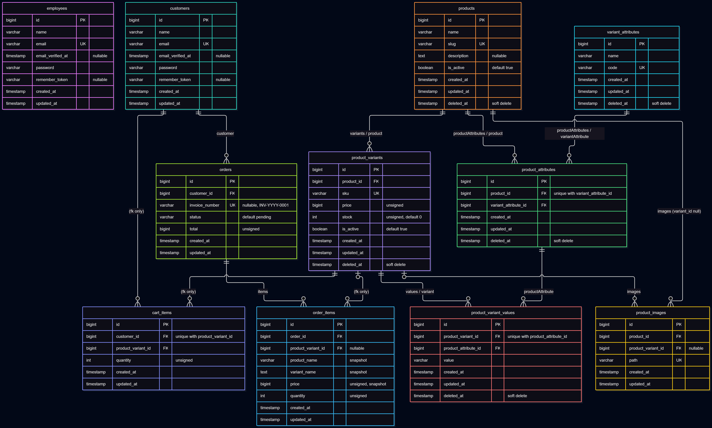

# Example E-Commerce

## 1. Live Demo

| Halaman        | URL                                                        |
| -------------- | ---------------------------------------------------------- |
| Storefront     | https://example-ecommerce.shaynendradika.my.id             |
| Login Customer | https://example-ecommerce.shaynendradika.my.id/login       |
| Login Admin    | https://example-ecommerce.shaynendradika.my.id/admin/login |

## 2. Akun Demo

| Role     | Email                  | Password |
| -------- | ---------------------- | -------- |
| Admin    | `admin@example.com`    | `123`    |
| Customer | `customer@example.com` | `123`    |

## 3. ERD

## 4. Tech Stack & Hosting

| Layer    | Tech                                                            |
| -------- | --------------------------------------------------------------- |
| Backend  | PHP, Laravel                                                    |
| Frontend | React, TypeScript, Inertia.js (SSR), Ant Design, Tailwind, Vite |
| Database | MySQL                                                           |
| CI/CD    | GitHub Actions                                                  |

Semua komponen berjalan di single VPS Ubuntu:

- **Backend:** Laravel handle routing, autentikasi (guard terpisah untuk admin dan customer), validasi, dan akses database.
- **Frontend:** React di-build dengan Vite, SSR Inertia running via pm2, frontend menerima data dari backend melalui props.
- **Storage:** Gambar produk & variant disimpan di local storage VPS oleh Laravel.
- **Database:** MySQL di VPS yang sama.
- **Deployment:** GitHub Actions auto-deploy via SSH setiap push ke `main`.
